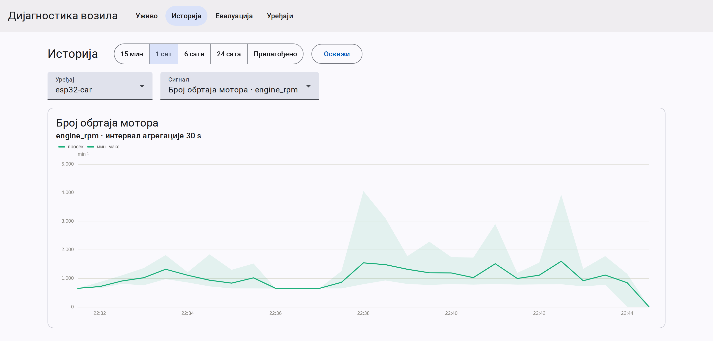
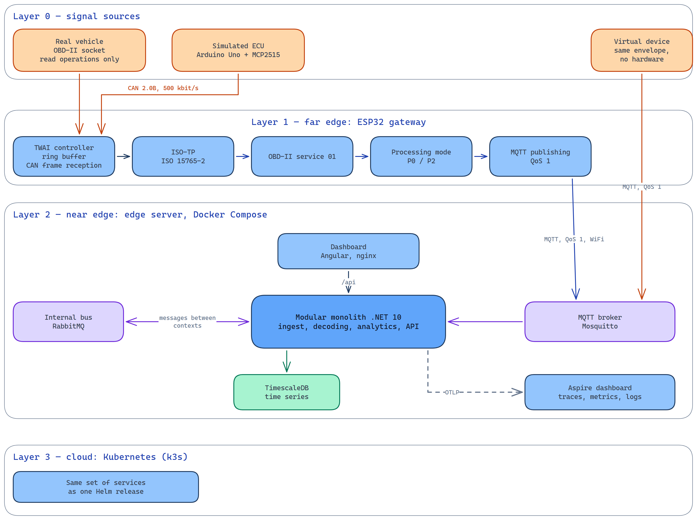
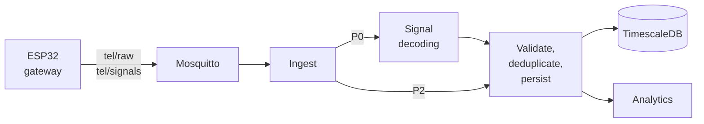
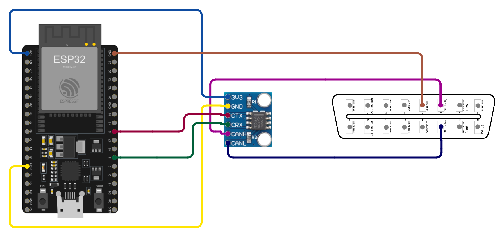
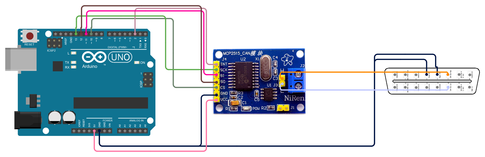
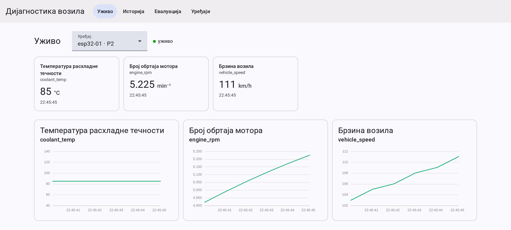
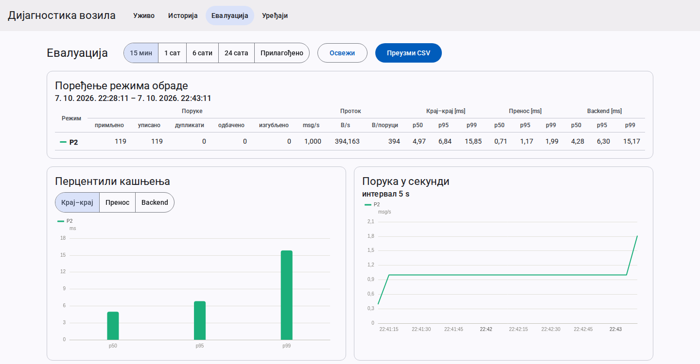
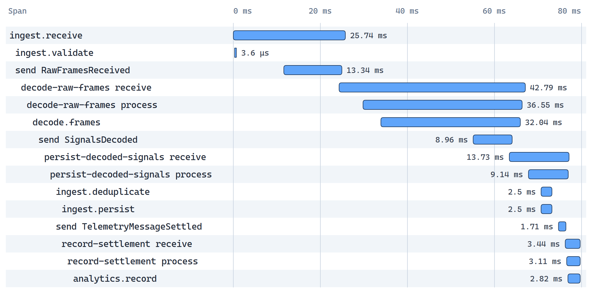

<h1 align="center">Vehicle Diagnostics IoT Platform</h1>

<p align="center">
  An ESP32 gateway reads engine data from a car's OBD-II port over the CAN bus and sends it to
  distributed services that decode, store and display it.
</p>

<p align="center">
  
  
  
  
  
  
  
  
  
  
</p>

<p align="center">
  <a href="#architecture">Architecture</a> ·
  <a href="#processing-modes">Processing modes</a> ·
  <a href="#hardware">Hardware</a> ·
  <a href="#dashboard">Dashboard</a> ·
  <a href="#tracing">Tracing</a> ·
  <a href="#quick-start">Quick start</a> ·
  <a href="#repository-layout">Repository layout</a>
</p>

<p align="center">
  
</p>
<p align="center">
  <sub>Engine speed during a 13-minute drive, recorded by the gateway in a car and shown on the dashboard's history page.</sub>
</p>

## About

This repository holds the code of the bachelor thesis *IoT систем за дијагностику возила
заснован на ESP32, CAN магистрали и дистрибуираним сервисима* (An IoT system for vehicle
diagnostics based on the ESP32, the CAN bus and distributed services) by Aleksandar Mitić,
Faculty of Electronic Engineering, University of Niš, 2026.

The thesis asks **where the data should be processed**: on the device in the car, on an edge
server nearby or in the cloud. To answer it the system does the same job in two ways and
measures both on the same input.

- **Embedded gateway.** An ESP32 with a CAN transceiver asks the engine control unit for its
  live values with OBD-II service 01 and publishes each polling cycle over WiFi and MQTT.
- **Server side.** A modular monolith on .NET 10 receives the messages, decodes them, writes
  them to a time-series database and serves them over REST and a live stream.
- **Two processing modes.** Decoding runs either on the ESP32 or in the backend, and a command
  over MQTT switches between them while the system runs.
- **Measurable end to end.** Every message carries a trace from the device to the database
  write, so latency, throughput and losses come from the system itself.
- **Runs without a car.** A simulated ECU on an Arduino and a virtual device in a container
  stand in for the vehicle on the bench and in load tests.
- **One system, three ways to run it.** .NET Aspire for development, Docker Compose on the edge
  server and a Helm chart for Kubernetes start the same set of services.

## Architecture



| Layer | What runs there |
|---|---|
| 0, signal sources | A real vehicle through its OBD-II socket, the simulated ECU on the bench, or a virtual device that sends the same messages with no hardware |
| 1, far edge | The ESP32 gateway: CAN controller, ISO-TP, OBD-II service 01, the processing mode and MQTT publishing |
| 2, near edge | The edge server: Mosquitto, the backend, RabbitMQ between its bounded contexts, TimescaleDB, the dashboard and the Aspire dashboard for telemetry |
| 3, cloud | The same set of services as one Helm release on a k3s cluster |

The backend is one process with three bounded contexts, telemetry, signal decoding and
analytics, built as a hexagonal architecture. The contexts share no database tables and talk to
each other only through messages on the internal bus. The full specification is in
[`docs/architecture.md`](docs/architecture.md) and the decisions behind it in
[`docs/adr`](docs/adr).

## Processing modes

| Mode | Device publishes | Decoding runs |
|---|---|---|
| **P0** | raw OBD-II answer frames on `tel/raw` | in the backend |
| **P2** | decoded readings on `tel/signals` | on the ESP32 |



In P0 the raw frames cross the internal bus to the decoding context and come back as decoded
signals; in P2 they are already decoded and go straight to the write. Either way the outcome of
every message is reported to the analytics context, which is where the comparison of the two
modes comes from.

Both modes use the same message envelope, and the mode is a runtime setting: no reflashing and
no redeploying. A retained MQTT command changes it on a running gateway:

```bash
mosquitto_pub -r -q 1 -t veh/bench-01/dev/gateway-01/cmd/req -m '{"processingMode":"P0"}'
```

<details>
<summary>Engine parameters the decoder knows</summary>

| PID | Signal | Unit |
|---|---|---|
| `0x04` | `engine_load` | % |
| `0x05` | `coolant_temp` | °C |
| `0x0B` | `intake_pressure` | kPa |
| `0x0C` | `engine_rpm` | min⁻¹ |
| `0x0D` | `vehicle_speed` | km/h |
| `0x0F` | `intake_temp` | °C |
| `0x10` | `maf_rate` | g/s |
| `0x11` | `throttle_position` | % |
| `0x2F` | `fuel_level` | % |
| `0x33` | `barometric_pressure` | kPa |
| `0x42` | `module_voltage` | V |
| `0x46` | `ambient_temp` | °C |

The gateway first asks the car which parameters it supports and polls only those.

</details>

## Hardware

| Part | Role |
|---|---|
| ESP32 development board | Gateway: CAN controller, WiFi and MQTT |
| SN65HVD230 | 3.3 V CAN transceiver for the gateway |
| Arduino Uno | Simulated engine ECU |
| MCP2515 module with a TJA1050 | CAN controller and 5 V transceiver for the simulator |
| OBD-II connector and socket | The gateway plugs into the simulator the same way it plugs into a car |

### Gateway



| ESP32 | SN65HVD230 | | SN65HVD230 | OBD-II |
|---|---|---|---|---|
| `3V3` | 3V3 | | CANH | pin 6, CAN high |
| `GND` | GND | | CANL | pin 14, CAN low |
| `GPIO5` | CTX | | | |
| `GPIO4` | CRX | | | |

The board's ground also goes to pin 5 of the connector, the signal ground.

### Simulated ECU



| Arduino Uno | MCP2515 module | | MCP2515 module | OBD-II |
|---|---|---|---|---|
| `5V` | VCC | | H | pin 6, CAN high |
| `GND` | GND | | L | pin 14, CAN low |
| `D10` | CS | | | |
| `D11` | SI | | | |
| `D12` | SO | | | |
| `D13` | SCK | | | |
| `D2` | INT | | | |

The Uno's ground also goes to pins 4 and 5 of the socket.

### On the bench and in a vehicle

| | Bench | Vehicle |
|---|---|---|
| Other node on the bus | Simulated ECU | The car's engine ECU |
| Termination on the gateway's transceiver | On; 120 Ω at both modules, 60 Ω in total | Off; the car's bus is already terminated |
| Power | USB | USB from a laptop, or pin 16 (+12 V) through a fuse and a 5 V converter |
| What the gateway sends | OBD-II service 01 requests | The same read requests and nothing else |

The vehicle build starts in listen-only mode and transmits nothing until that is switched off.
The firmware has no write, reset or routine-control services. Read the safety notes in
[`docs/diagrams/hardware-wiring.md`](docs/diagrams/hardware-wiring.md) before connecting
anything to a car; building, flashing and the bench procedure are in
[`firmware/README.md`](firmware/README.md).

## Dashboard

An Angular application with four pages: devices, live values, history and the evaluation of the
two processing modes. It reads only the backend's public `/api`, and its interface is in
Serbian. The history page is the picture at the top of this page.

<table>
  <tr>
    <td width="50%" valign="top"></td>
    <td width="50%" valign="top"></td>
  </tr>
  <tr>
    <td valign="top"><b>Live.</b> The latest values and a rolling chart for each signal, pushed from the server as they arrive.</td>
    <td valign="top"><b>Evaluation.</b> Messages received, written, duplicated, rejected and lost, the data rate and the latency percentiles for each mode, with a CSV export.</td>
  </tr>
</table>

## Tracing

The trace context starts on the device and travels inside the message over MQTT and over the
internal bus, so one message is one trace from the broker to the database write. The spans of a
single P0 message, as the Aspire dashboard shows them:



The same instrumentation produces the numbers on the evaluation page.

## Tech stack

| Part | Technology |
|---|---|
| Gateway firmware | C on ESP-IDF 5.5, TWAI driver, ISO-TP, MQTT client |
| Simulated ECU | Arduino C++ on an Uno with an MCP2515 |
| Backend | .NET 10, ASP.NET Core Minimal APIs, MQTTnet, MassTransit, EF Core with Npgsql |
| Messaging | Mosquitto for the devices, RabbitMQ between the bounded contexts |
| Storage | TimescaleDB on PostgreSQL 17 |
| Dashboard | Angular 22, Angular Material, ECharts |
| Observability | OpenTelemetry, .NET Aspire dashboard |
| Deployment | .NET Aspire, Docker Compose, Helm on k3s |
| Tests | xUnit, Testcontainers, NetArchTest, Vitest; firmware tests on the host and on an emulated ESP32 |

## Quick start

The whole server side in containers, with a virtual device that publishes once a second. Only
Docker is needed:

```bash
cd deploy/compose
docker compose --profile demo up -d --build
```

| What | Address |
|---|---|
| Dashboard | http://localhost:4280 |
| API and health | http://localhost:5080 |
| Traces, metrics and logs | http://localhost:18888 |
| MQTT broker | `localhost:1883` |

Development with .NET Aspire is described in [`backend/README.md`](backend/README.md), the
Kubernetes path in [`deploy/README.md`](deploy/README.md) and the firmware toolchain in
[`firmware/README.md`](firmware/README.md).

## Repository layout

| Folder | Contents |
|---|---|
| [`firmware/gateway`](firmware/gateway) | ESP32 gateway in C on ESP-IDF: CAN link, ISO-TP, OBD-II service 01, MQTT publishing |
| [`firmware/sim-ecu`](firmware/sim-ecu) | Simulated engine ECU on an Arduino Uno with an MCP2515, for repeatable bench runs |
| [`firmware/tools/sil`](firmware/tools/sil) | Software-in-the-loop bench: the gateway's scheduler against the simulator, no hardware |
| [`backend`](backend) | Modular monolith on .NET 10: telemetry, signal decoding and analytics contexts |
| [`frontend`](frontend) | Angular dashboard |
| [`deploy`](deploy) | Docker Compose stack and a Helm chart for Kubernetes (k3s) |
| [`edge`](edge) | Mosquitto broker configuration |
| [`experiments`](experiments) | Virtual device used as a load generator, capture fixtures and a recorded drive profile |
| [`docs`](docs) | System specification, architecture decision records, diagrams and the images on this page |

## Tests

```bash
cd backend && dotnet test VehicleDiagnostics.slnx    # unit, architecture and integration tests
make -C firmware/gateway/test/host                   # firmware tests on a development machine
make -C firmware/sim-ecu/test/host                   # simulator tests
```

The integration tests start their own containers and need Docker.
