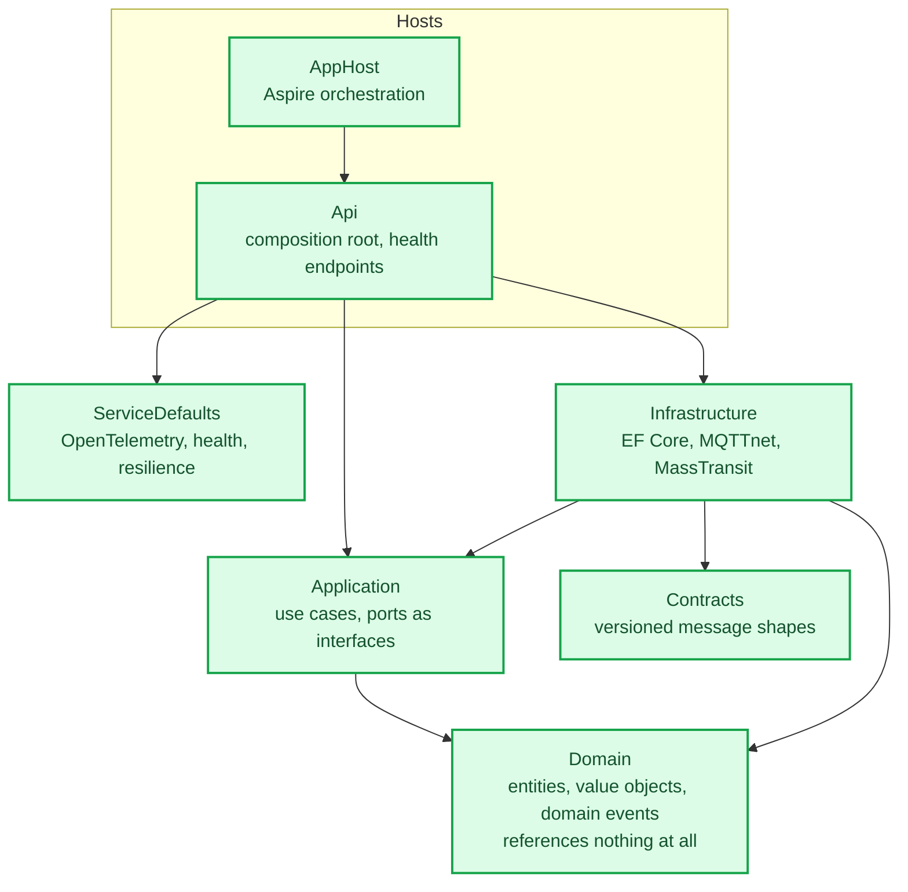
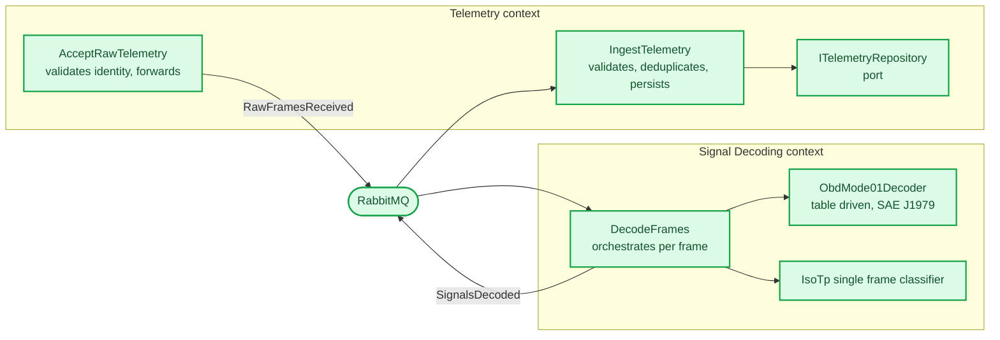
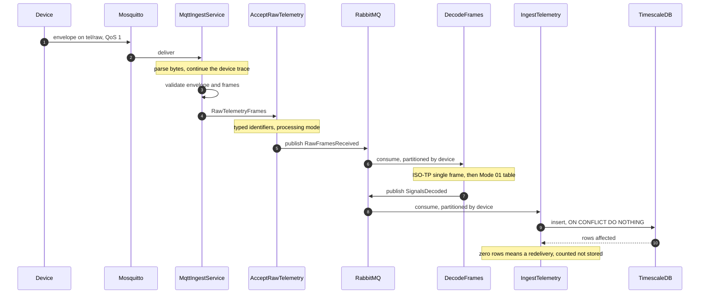
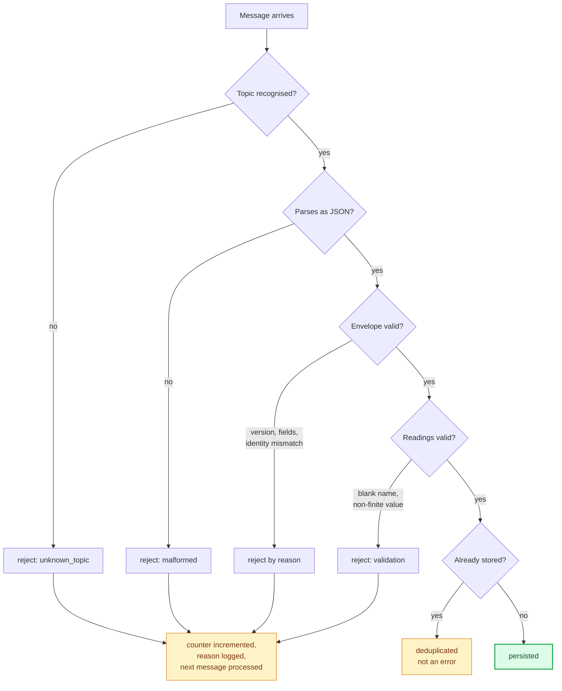
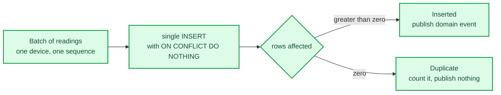
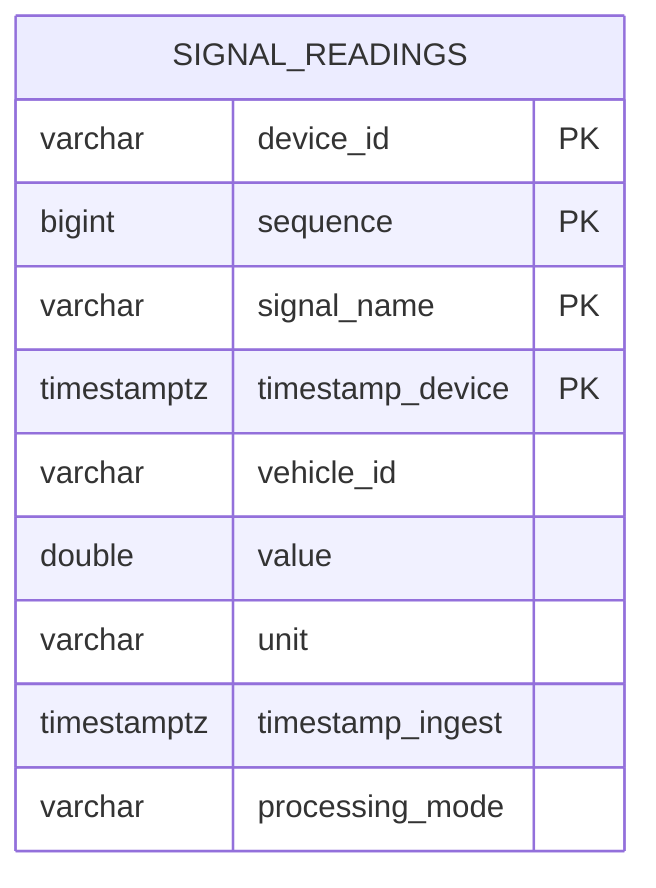
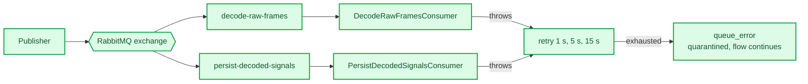
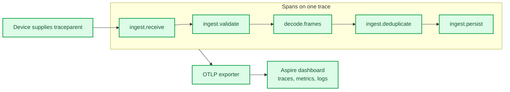
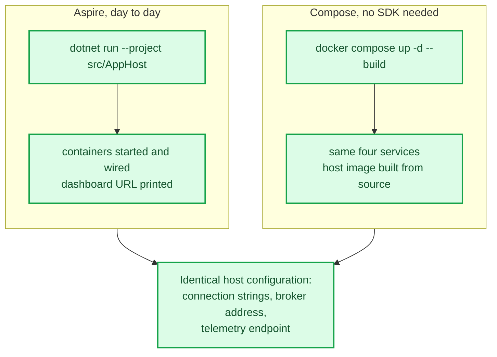

# Backend in detail

How the .NET side actually works, at the level of the types and messages that exist in the
code. The system overview is in `system-architecture.md`; this document goes one level down.

Everything shown here is implemented and covered by tests unless marked otherwise.

---

## 1. Projects and the dependency rule

Dependencies point inward only, and that is enforced by architecture tests on every build
rather than by convention.

The Domain project's file lists no package and no project reference. Time reaches it only
through an injected abstraction, so its behaviour is deterministic under test. An attempt to
reference outward fails the architecture suite with the offending type named.

---

## 2. Bounded contexts inside the monolith

Contexts are namespaces today and become separate services when there is a reason. They never
share tables and never call each other directly.

Note the shape: the Telemetry context both starts and ends the round trip. It accepts raw
frames, hands them away, and later receives decoded readings back to persist. Decoding never
touches the database, and persistence never parses a frame.

---

## 3. The P0 path, frame by frame

A gateway in mode P0 sends raw CAN frames and the backend decodes them.

The P2 path is the same picture with the middle removed. A device that decoded on board
publishes on the signals topic, and the ingest service hands it straight to `IngestTelemetry`.
Both paths converge on the same persistence and the same deduplication, which is why their
results are directly comparable.

---

## 4. What happens to a message that is wrong

Every failure is counted by reason and none of them stops the pipeline.

A poison message is proven not to stop ingestion by an integration test that publishes one
between two valid messages and asserts the second still lands.

---

## 5. Deduplication, and why it is in the database

At-least-once delivery means the same message will arrive twice. The store decides, not the
application, because only the store is both restart-safe and race-free.

The key is `(device_id, sequence, signal_name, timestamp_device)`. Signal name is in it because
one sequence carries several readings. The time column is in it because TimescaleDB requires the
partitioning column in any unique constraint. A redelivered batch collides on every row, so
batch-level deduplication still holds, and a partially stored batch heals itself on redelivery.

---

## 6. Storage

One hypertable in its own `telemetry` schema, partitioned on device time. Two timestamps are
stored deliberately: the device's own sample time and the moment the backend wrote it. Their
difference is transport latency, which is one of the numbers the evaluation reports, and it
cannot be recovered later if only one is kept.

`processing_mode` records which mode produced the row, so a P0 run and a P2 run stay
distinguishable in the same table.

---

## 7. The internal bus

Messages from one device are serialized by a partitioner keyed on the device identifier, so
order per device holds while different devices proceed in parallel. That guarantee is valid only
while the consumer runs in a single process, which is recorded as a precondition in ADR-0004 and
must be revisited before any consumer is extracted or scaled out.

Two behaviours are proven by integration tests rather than assumed: a transient database outage
is retried and the message lands exactly once afterwards, and a message that fails every retry
is quarantined while later messages keep flowing.

---

## 8. Observability

The trace begins on the device and survives both bus hops, so end-to-end latency is measurable
as one number rather than stitched together afterwards. An integration test asserts the persist
span carries the device's trace identifier.

One subtlety worth knowing: the bus propagates trace context only while something listens to its
activity source. In a running host the telemetry SDK is that listener. A host configured without
observability would silently lose cross-bus trace continuity, which is one more reason the
shared defaults are mandatory for every host.

| Counter | Meaning |
|---|---|
| `ingest.messages.received` | Everything the broker delivered |
| `ingest.messages.rejected` | Tagged by reason |
| `ingest.messages.deduplicated` | Redeliveries collapsed by the store |
| `ingest.messages.persisted` | Rows actually written |
| `ingest.messages.raw_forwarded` | Raw envelopes handed to decoding |
| `ingest.trace_continuity_lost` | Envelopes whose trace context was malformed |
| `decode.frames.received` | Frames handed to the decoder |
| `decode.frames.decoded` | Frames that produced a reading |
| `decode.frames.ignored` | Tagged by reason |
| `decode.envelopes.empty` | Raw envelopes that yielded nothing |

---

## 9. The two ways to run it

The host reads the same environment variables either way and contains no code that knows which
path started it. Compose additionally builds the host from source in a multi-stage image, so a
machine with only a container engine can run the whole stack.

| | Aspire | Compose |
|---|---|---|
| Needs the .NET SDK | yes | no |
| Host readiness | `localhost:5080/health` | `localhost:5080/health` |
| Broker | `localhost:1883` | `localhost:1883` |
| Bus management | dashboard link | `localhost:15672` |
| Telemetry UI | printed at start-up | `localhost:18888` |
| Virtual device | run from the host | `--profile demo` |

---

## 10. What is not built yet

| Context or feature | Status |
|---|---|
| Device Management, registration, health, runtime mode switching | Planned. This is the thesis's central mechanism and has no implementation |
| Diagnostics, UDS sessions, fault codes, security access | Planned, simulator only |
| Analytics, windows, aggregates, anomaly detection | Planned |
| Source attribution, which device is a car and which a simulator | Not present. Needed to keep measurements separable and to guard write operations |
| Edge and cloud split, aggregate forwarding, retention tiers | Planned |
| Alternative serialization for the bandwidth comparison | Planned |
