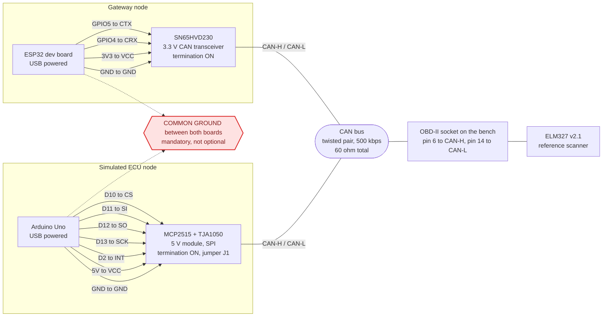
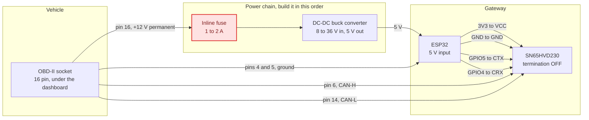
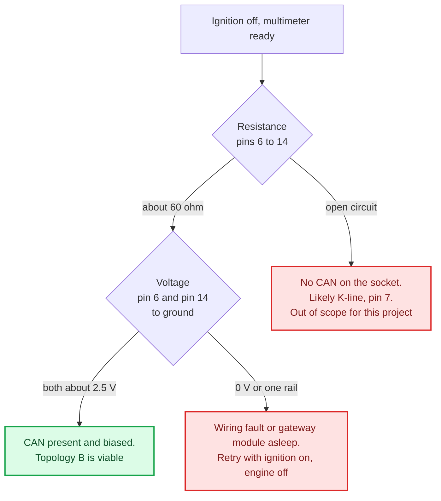

# Hardware wiring

How to connect the ESP32 gateway, on the bench and in a vehicle. Pin assignments come from
`../architecture.md` §3 and are repeated in `../../firmware/CONVENTIONS.md`.

**Read the safety section before touching a vehicle.** Pin 16 of the diagnostic socket is live
with the ignition off and the key out.

---

## 1. Bench, topology A

Everything runs on USB power. Nothing here can damage a vehicle because no vehicle is involved,
which is why every piece of protocol work happens on the bench first.

### Pin tables

| ESP32 | SN65HVD230 | Note |
|---|---|---|
| `3V3` | VCC | **3.3 V, never 5 V.** This transceiver is a 3.3 V part |
| `GND` | GND | |
| `GPIO5` | CTX, sometimes marked D | Controller transmit |
| `GPIO4` | CRX, sometimes marked R | Controller receive |

| Arduino Uno | MCP2515 module | Note |
|---|---|---|
| `5V` | VCC | The module and its TJA1050 are 5 V parts |
| `GND` | GND | |
| `D10` | CS | SPI chip select |
| `D11` | SI | Controller in, from the Uno |
| `D12` | SO | Controller out, to the Uno |
| `D13` | SCK | SPI clock |
| `D2` | INT | Interrupt, must be a pin that supports interrupts |

The two nodes run at different logic voltages, which is fine. They are joined by the CAN bus,
which is differential and does not care, not by a logic-level connection.

### Bench checklist, in this order

| # | Check | Expected | If wrong |
|---|---|---|---|
| 1 | Resistance across CAN-H and CAN-L, power off | about 60 Ω | 120 Ω means only one end is terminated; near 0 Ω means a short |
| 2 | Continuity between the two boards' grounds | connected | Add the ground link. Without it the bus looks dead |
| 3 | Crystal marking on the MCP2515 module | matches `QUARTZ_FREQUENCY` in the sketch | Edit the constant. The sketch prints its value at start-up |
| 4 | Both consoles at 115200 baud | banners appear | Check the USB cable carries data, not only power |

Those four account for nearly every bench that will not come up. Only after all four pass is a
silent bus worth blaming on firmware.

---

## 2. Vehicle, topology B

### Two differences from the bench that matter

**Termination must be OFF.** The vehicle bus is already terminated at both ends by the vehicle.
Adding a third resistor drops the bus impedance and can stop communication for every module on
it, not only yours. Remove the jumper or desolder the resistor on the transceiver module before
the first connection.

**The supply is hostile.** Pin 16 sits at roughly 12 V but swings with the alternator and can
spike far higher when inductive loads switch. It is permanently live. The fuse protects the
vehicle's wiring, and the buck converter protects your board. Neither is optional, and for the
first sessions a power bank into the ESP32's USB port avoids the vehicle supply entirely while
you confirm the bus works.

### Socket pinout

Standard ISO 15765-4 assignment. Only four pins matter for this project.

| Pin | Signal | Used here |
|---|---|---|
| 4 | Chassis ground | Yes |
| 5 | Signal ground | Yes, preferred for signal reference |
| 6 | CAN High | Yes |
| 14 | CAN Low | Yes |
| 16 | Battery positive, permanent | Yes, through fuse and converter |
| 7 and 15 | K-line and L-line, older protocols | No |
| 2 and 10 | SAE J1850 bus | No |

**Verify with a multimeter before trusting any pin numbering.** Connector orientation is easy to
mistake and pin 16 is live. With the ignition off, confirm about 12 V between pin 16 and pin 4,
and about 60 Ω between pins 6 and 14. If those two readings are right, your numbering is right.

### Is CAN even present?

Not every vehicle exposes CAN on the socket. Before planning around it:

This is a fifteen-minute check that retires the project's highest-impact unknown. If CAN is
absent, the bench and the simulator carry the whole evaluation, which is survivable, but the
plan needs to know early rather than late.

---

## 3. Safety rules

These are not suggestions. They come from `../architecture.md` §16 and are repeated in the
firmware conventions.

- **Read-only services against a real vehicle.** OBD-II Modes 01, 03 and 09 only.
- **Never** a reset, a write by identifier, a routine, or programming against a vehicle, in any
  code path, not even behind a flag that defaults to off. Those exist for the simulator, guarded
  by an explicit destination check.
- The vehicle stays **parked** during measurement, never moving.
- **Unplug the device** when you finish. Pin 16 is live with the key out and a permanently
  connected device will flatten the battery over days.
- The fuse goes on the **+12 V line**, close to the socket. Its job is protecting the vehicle's
  loom, which you cannot repair, not protecting your board, which you can replace.

---

## 4. Signal reference

| Property | Value |
|---|---|
| Bus | Classic CAN 2.0, not CAN FD |
| Bit rate | 500 kbit per second |
| Termination, bench | 120 Ω at both ends, 60 Ω total |
| Termination, vehicle | None added; the vehicle provides it |
| Idle level | Both lines near 2.5 V |
| Dominant bit | CAN-H rises toward 3.5 V, CAN-L falls toward 1.5 V |
| Diagnostic request identifiers | `0x7DF` functional, `0x7E0` to `0x7E7` physical |
| Diagnostic response identifiers | `0x7E8` to `0x7EF` |
