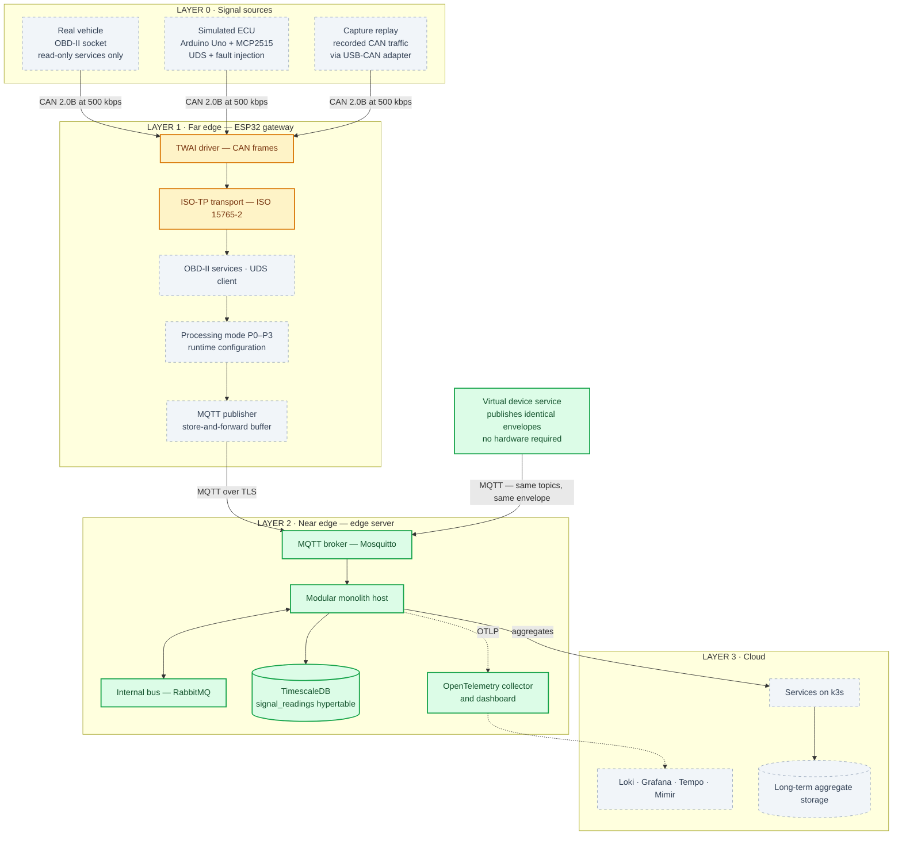
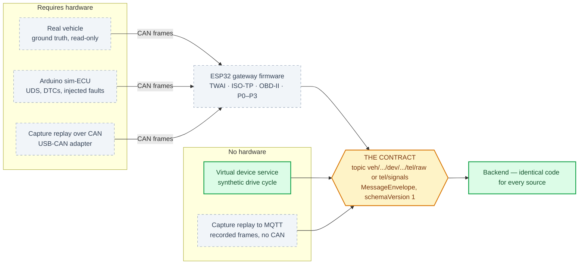
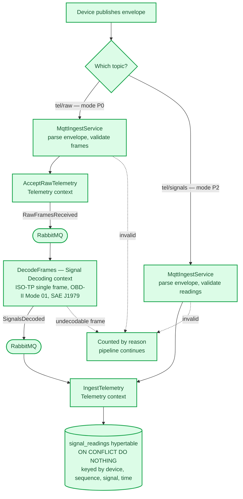
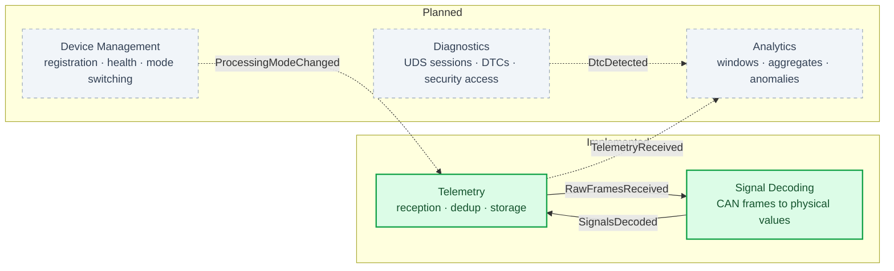
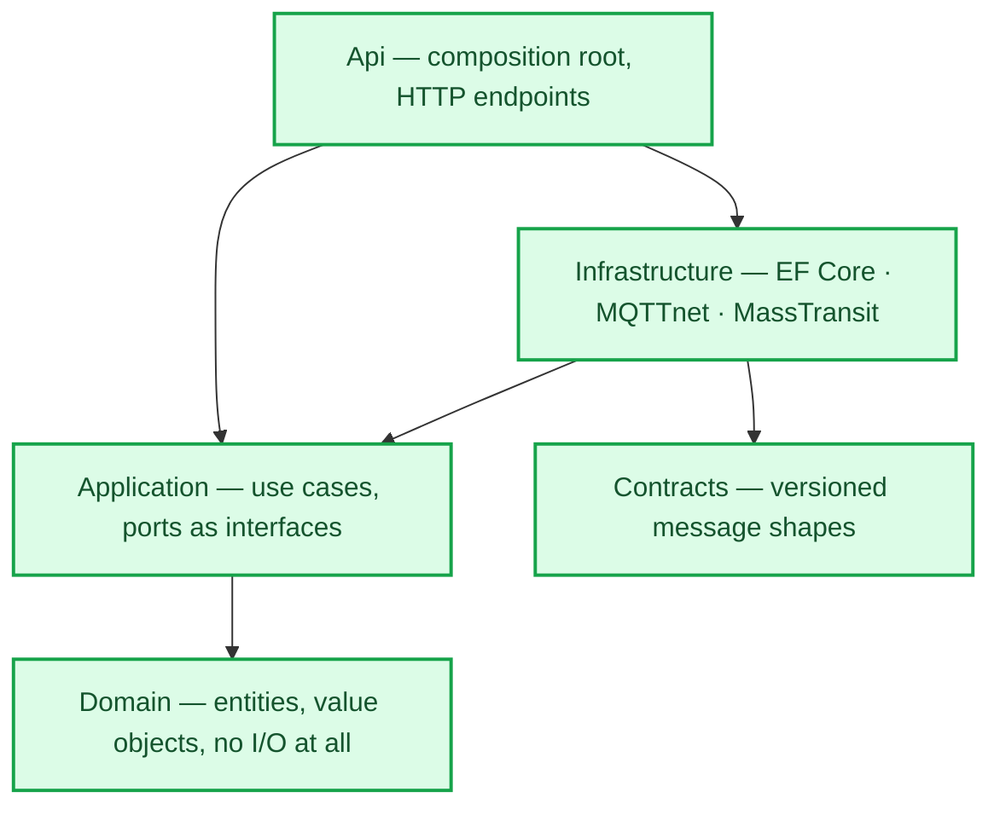
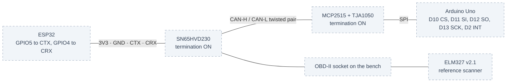

# System architecture diagrams

Visual companion to `../architecture.md`, which stays the single source of truth. Where a
diagram and that document disagree, the document wins and the diagram is the bug.

Status marking is deliberate: this is a thesis in progress, so each diagram distinguishes what
is **implemented and verified**, what is **built but not yet wired into a running path**, and
what is **specified but not yet built**.

Companion documents: `hardware-wiring.md` for how to connect the boards, `backend-detail.md`
for the server side at the level of its actual types and messages.

---

## 1. Whole system

Three physical layers, plus the signal sources that feed them.

Green with a solid border is implemented and verified. Amber is built and tested but not yet
wired into a running path: the CAN link layer runs but sends only a fixed frame, and the ISO-TP
transport layer is complete and covered by tests without the diagnostic client that will drive
it. Grey with a dashed border is specified but not yet built.

**Architecture invariant.** The boundary and the protocol between layers are identical in every
processing mode. Only *which layer performs which phase* changes. Without that invariant the
mode comparison is not a fair test, and the fair test is the thesis.

---

## 2. Signal sources and where each one injects

Five ways to get data in, at two injection points. This is the property that lets the system be
developed and measured without a vehicle present.

| Source | Injects at | Exercises | Hardware |
|---|---|---|---|
| Real vehicle | CAN | firmware and backend, real timing | vehicle, gateway |
| Arduino sim-ECU | CAN | firmware and backend, repeatable | bench, gateway |
| Capture replay over CAN | CAN | firmware and backend, byte-identical runs | USB-CAN adapter |
| Virtual device service | MQTT | backend only | none |
| Capture replay to MQTT | MQTT | backend only | none |

Two injection points, and the difference matters. A CAN-level source replaces the **vehicle**, so
the firmware still runs and its timing is measured. An MQTT-level source replaces the **whole
device**, so the firmware is bypassed entirely and only backend behaviour is under test.

---

## 3. Ingest pipeline — how P0 and P2 converge

Both processing modes reach the same storage path through the same deduplication, which is why
their results are directly comparable.

The whole path carries one W3C trace identifier, from the device through both bus hops into the
database. Losing that continuity would make the end-to-end latency unmeasurable, so it is
asserted by an integration test rather than assumed.

---

## 4. Bounded contexts

Contexts talk only through published messages. No context reads another's tables.

Inside the monolith each context is its own namespace, and the separation is enforced by
architecture tests rather than by convention. When a context is extracted into a service, the
namespace boundary becomes a project boundary and the same tests keep passing.

---

## 5. Dependency rule

Dependencies point inward only. Verified by NetArchTest on every build.

The Domain project references nothing: no projects, no packages, no clock. Time enters through
an injected abstraction so domain behaviour is deterministic under test.

---

## 6. Bench topology

Common ground is mandatory. Total termination measures about 60 Ω, from two 120 Ω resistors in
parallel. In a real vehicle the termination on the transceiver module must be **off**, because
the vehicle bus is already terminated at both ends.
